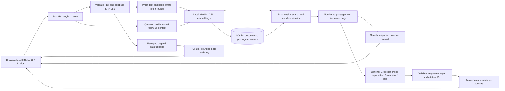
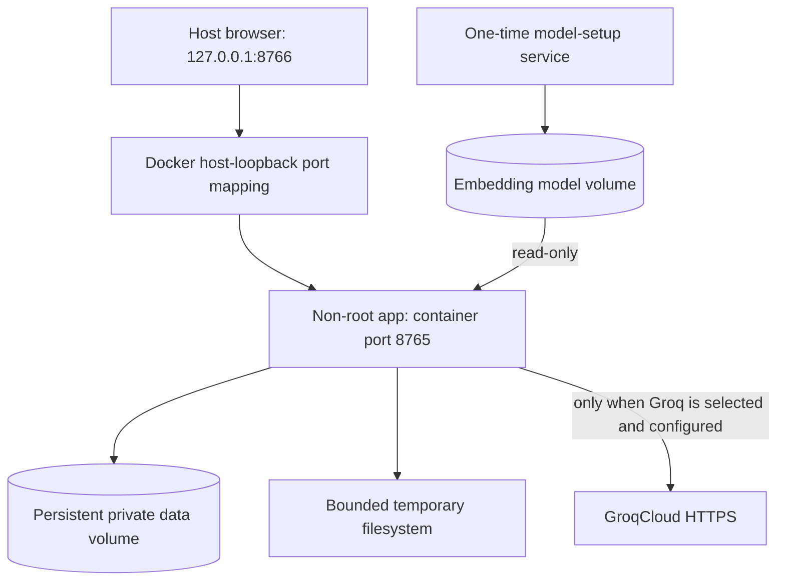

# Architecture

## Purpose And Scope

The assistant helps a single user explore and learn from text-based PDFs on a
resource-constrained computer. Retrieval is local. Groq generation is an explicit
cloud option; local llama.cpp evidence selection is an experimental native-mode
alternative. This is not an authenticated multi-user service or a production SLA.

## Data Flow

The model is not trained on uploaded documents. RAG supplies selected passages at
request time. A citation being valid does not prove that the passage entails the
claim. The exact insufficient-information message is rendered when the generator
abstains; the model's decision to abstain can still be wrong.

## Component Ownership

| Component | Responsibility |
| --- | --- |
| `src/documents_loader.py` | Content hashes, extractable text, original page metadata |
| `src/embeddings.py` | Offline model loading, bounded CPU threads, token-aware chunking, model fingerprint |
| `src/vector_store.py` | Transactional indexing, persistence, exact ranking, deletion |
| `src/rag.py` | Ingestion/retrieval orchestration and retrieved-text deduplication |
| `src/groq_generation.py` | Fixed HTTPS provider endpoint, tutor prompt, schema/citation validation, controlled errors |
| `src/generation.py` | Loopback-only local generation and quote-provenance safeguards |
| `src/web.py` | Uploads, managed originals, concurrency, API protection, previews, secret-in-memory settings |
| `src/static/` | Local interface, safe text rendering, citation inspection, bounded session history |

## Design Decisions

- **Small CPU embedding model:** indexing/search do not need the 2 GB GPU or a cloud embedding subscription.
- **SQLite with exact search:** a simple, inspectable baseline for a small single-user collection. This does not demonstrate large-scale throughput.
- **Stable model identity:** incompatible embedding spaces cannot silently share the same index.
- **Content-addressed documents:** byte-identical uploads skip embedding; changed bytes become a separate version.
- **Atomic index publication:** failed embedding/indexing does not publish a partially searchable document. Crash recovery for orphaned archive files remains future work.
- **Provider separation:** Groq generation does not change the local index. Search does not create a Groq client or require a key.
- **One operation at a time:** a process-local lock rejects concurrent indexing/query/deletion instead of creating an unbounded queue. It is not a distributed lock.
- **Bounded context:** at most five retrieved passages and two previous turns in the web API. Previous answers are context, not evidence; recent question topics are carried into follow-up retrieval.
- **Visible provenance:** answers and source passages remain separate, with actual PDF page inspection.

## Container Boundary

The web process explicitly listens on `0.0.0.0` **inside** Docker so published
ports work. Compose publishes only to the host's `127.0.0.1`. Native startup still
defaults to loopback. Do not expose this application to the internet: host checks
and a workspace token are not user authentication.

Compose limits the app to two CPUs, 4 GB memory, and 128 processes, drops Linux
capabilities, enables no-new-privileges, and uses a read-only root filesystem.
These are container constraints, not a benchmark or a complete sandbox for hostile PDFs.
Docker Desktop and other host processes consume memory outside this app's limit.

Compose packages local retrieval and Groq tutoring. It does not bundle a Qwen model
server; selecting Local excerpts inside this container will report unavailable.
The native app still supports the separately started local llama.cpp server.

## Privacy And Secrets

Private PDFs, databases, downloaded models, `.env`, keys, and local environments are
not copied into the image. The build copies only source and dependency manifests.
Models are provisioned separately; data persists in its own volume.

The default Compose configuration passes no API key. Users connect Groq through
the local password field. The backend holds that key in memory; status/health
responses never return it. Restart/disconnect clears the UI-configured key.
The optional startup `GROQ_API_KEY` is for trusted deployments and is not loaded
from `.env` automatically. No real key is needed in CI.

Groq requests include question text, selected passages, filename/page labels, and
recent context. They are not offline or fully private. Cloud provider retention
and billing are governed by the user's account. Document text is rendered as text,
not model-provided HTML; no runtime CDN is used.

## Verification Boundaries

Unit/API tests exercise indexing behavior, deletion, PDF handling, generation errors,
quote safeguards, citation IDs, CSRF/host checks, and secret non-disclosure.
Desktop/mobile checks use an isolated workspace and mocked Groq transport.
Container tests verify Linux execution with networking disabled. A separate real
model smoke check can verify ingestion/search without modifying the native index.

The GitHub workflow runs on push/pull request after publication. A workflow file in
a local directory is not evidence that a remote CI run passed. Model answer quality,
learning impact, and production capacity have not been formally established.

## References

- [Docker host-loopback port publishing](https://docs.docker.com/engine/network/port-publishing/)
- [Docker Compose service configuration](https://docs.docker.com/reference/compose-file/services/)
- [GitHub Actions secure-use guidance](https://docs.github.com/en/actions/reference/security/secure-use)
